# HMAG: Hierarchical Memory-Augmented Generation for Efficient LLM Inference

This repository contains the implementation of HMAG, the baselines, the experiment scripts, the
raw measurements reported in the paper, and the scripts that compute every table
and number from them.

## Architecture

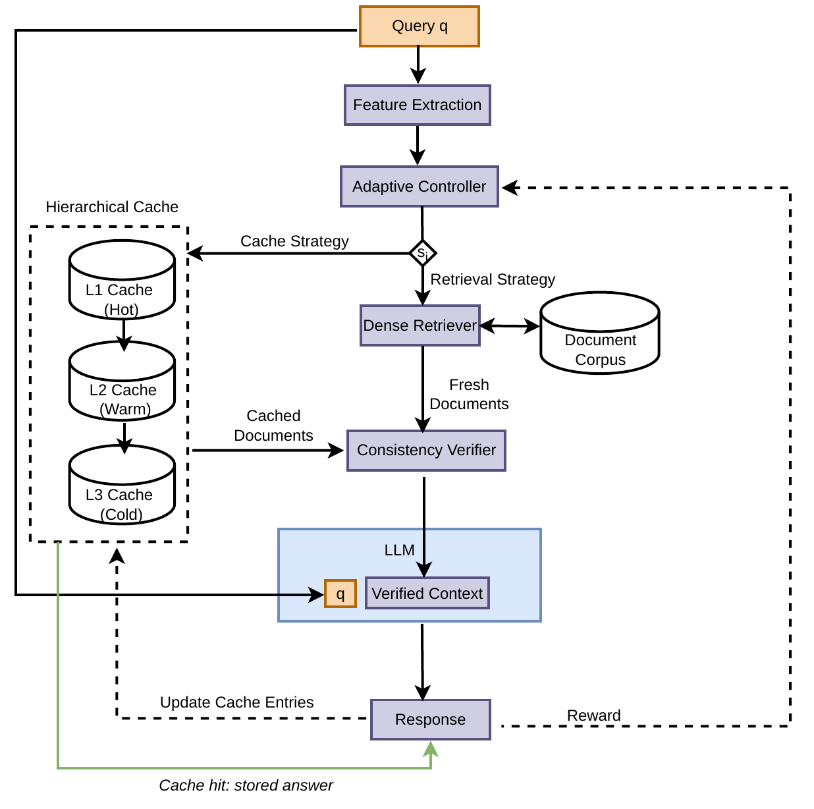

A query that repeats a cached question is answered from the three-tier answer cache. Otherwise
the adaptive controller selects a retrieval strategy, the consistency verifier checks cached
against freshly retrieved documents, and the LLM generates the answer, which enters the cache.

## Layout

```
code/      implementation, baselines, experiment drivers, table and figure scripts, tests
results/   raw per-query measurements (CSV) and the computed tables (results/tables)
figures/   the figures of the paper as images
```

## Implementation

| File | Content |
|---|---|
| `hmag_core.py` | three-tier answer cache (Algorithm 1): priority of Eq. (3), admission test, promotion with exchange, slot indexes per tier |
| `hmag_system.py` | HMAG pipeline: verbatim lookup, Thompson-sampling controller, retrieval, verifier, generation; `HMAGConfig` holds all defaults |
| `hmag_retrieval.py`, `hmag_verifier.py` | dense retrieval (FAISS) and consistency verifier |
| `hmag_baselines.py` | Static RAG, SCALM, ContextCache, CAG, MinCache, SmartCache, Adaptive-RAG |
| `hmag_datasets.py`, `hmag_paraphrase.py` | workloads: Zipf streams over SQuAD v2.0, Natural Questions and MS MARCO; dynamic workload; paraphrase banks and reworded streams |
| `hmag_benchmark.py`, `hmag_qa_metrics.py`, `hmag_profiling.py` | per-query runner, quality metrics, GPU/CPU/energy monitoring |

Default cache configuration (`HMAGConfig`): L1/L2/L3 = 1,500 / 2,100 / 7,500 answers; a new
answer is stored in the lowest tier with room; a hit promotes the answer after it has been
returned, exchanging it with the lowest-priority entry of a 64-entry sample of L1 when L1 is
full (promotion threshold 0.5); the frequency term of Eq. (3) is log(1+f)/log(1+f_max).
All durations are measured with `time.perf_counter` (monotonic).

## Experiments

All GPU experiments use Ollama on one RTX-class GPU with the following model builds:

| Role | Model | Ollama tag | Ollama ID |
|---|---|---|---|
| Generator | Llama 3.2, 3.2B, Q4_K_M | `llama3.2:latest` | `a80c4f17acd5` |
| Second generator | Qwen3 4B Instruct 2507, Q4_K_M (`hf.co/unsloth/Qwen3-4B-Instruct-2507-GGUF:Q4_K_M`) | `qwen3-4b-instruct:latest` | `835c4e71a3ac` |
| Paraphrase generation | Llama 3 8B, Q4_0 | `llama3:latest` | `365c0bd3c000` |

Both generators use a 4,096-token context, temperature 0.7 and at most 1,024 output tokens. `revision_results_queue_v9_hmag.sh` is the exact sequence of HMAG
runs; the baselines were run with the same drivers and settings.

| Script | Paper section | Output (results/) |
|---|---|---|
| `run_hmag500.py`, `run_main500.py` | main streams, concurrency, second model, temperature | `v9/hmag500`, `v9/main500`, `v8/main500` |
| `run_paraphrase500.py` (`PARA_WORKLOAD=zipf CACHE_CAPACITY=100 CACHE_TIERS=25,25,50`) | main comparison, popular questions with rewordings, equal capacity | `v9/main_zipf` |
| `run_paraphrase500.py` | reworded repeats | `v9/paraphrase500` |
| `run_dynamic500.py` | changing popularity | `v9/dynamic500` |
| `run_revision_experiments.py`, `ablation.py`, `hmag_sensitivity.py` | ablations, capacity, sensitivity | `v9/r500` |
| `hmag_verifier_eval.py` | verifier evaluation | `v8/r500` |
| `run_stress.py` (design in `STRESS_TEST_DESIGN.md`) | capacity pressure, 100 answers | `v9/stress` |
| `placement_benchmark.py` | tier placement and search cost (CPU, cache only) | `placement` |
| `theory_assumption_runs.py` | assumptions of the analysis | `theory` |
| `cache_replay.py` | trace replay of the cache policies | `replay` |

Baseline rows of the main streams come from `v8` (same code, settings and timer); the `v9`
files contain the HMAG runs and a copy of the baseline rows of the same stream.

## Results

The figures of the paper, computed from the measurements in `results/`.

**Cache hit rates of the answer caches on the five workloads**

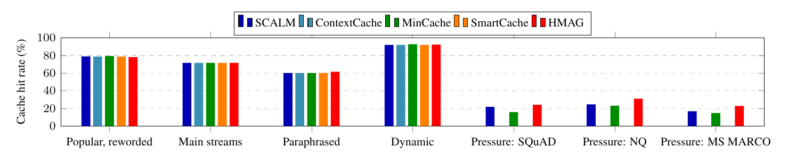

**Time of the processing stages before generation (left) and of generation on a miss (right)**

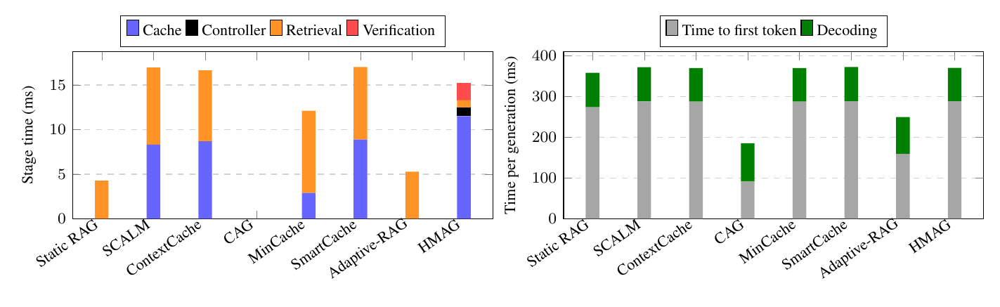

**Peak memory (left) and average GPU power (right)**

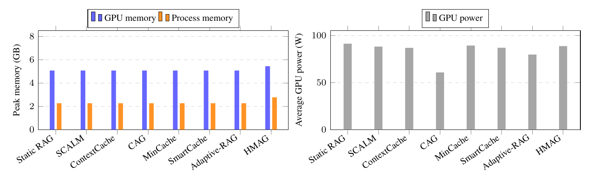

**Throughput (left) and p95 latency (right) under concurrent requests**

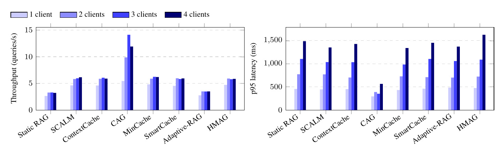

**Hyperparameter sensitivity**

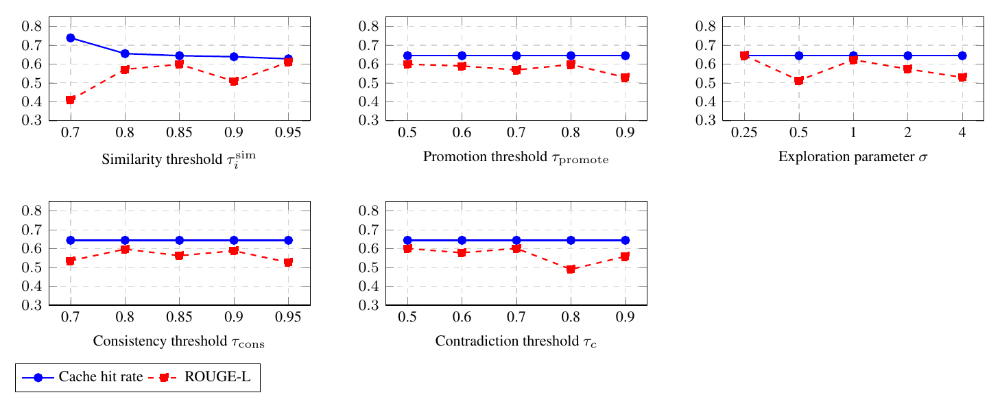

**Cache hit rate (left) and latency (right) in each phase of the dynamic workload**

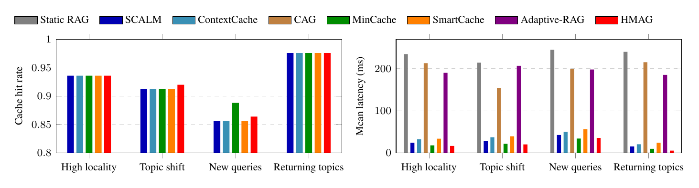

**Latency (left) and quality (middle) against cache size, and cache hit rate against the Zipf exponent (right)**

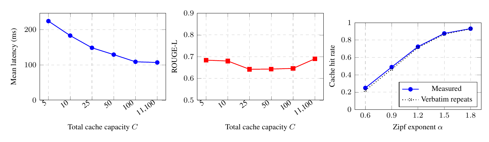

**Strategy-selection frequency of the Thompson-sampling controller**

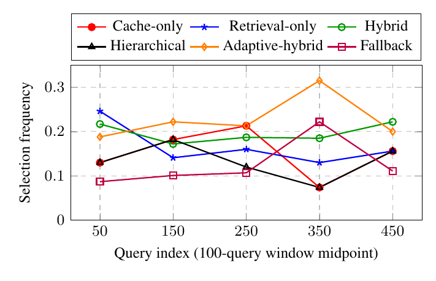

**HMAG latency (left) and quality (right) at different sampling temperatures**

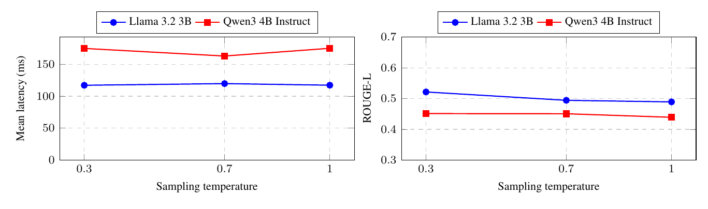

**Mean cumulative regret of the Thompson-sampling controller**

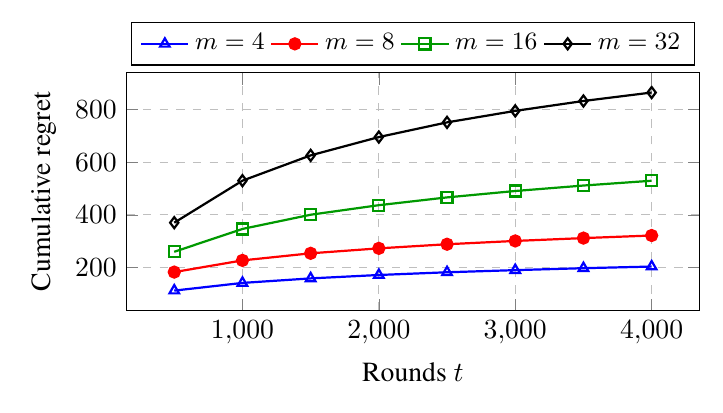

## Data and licenses

The raw measurements contain the questions and reference answers of the three benchmarks, and
`results/paraphrase_bank` contains rewordings of their questions. These derived files remain
subject to the licenses of the source datasets:

- SQuAD v2.0 (Rajpurkar et al., 2018): CC BY-SA 4.0.
- Natural Questions (Kwiatkowski et al., 2019): CC BY-SA 3.0.
- MS MARCO (Nguyen et al., 2016): Microsoft's terms of use, which permit non-commercial research use.

The generated answers come from Llama 3.2 and Qwen3 4B Instruct, and the paraphrases from
Llama 3 8B.

## Reproducing the tables

```
pip install -r code/requirements.txt
cd code
python build_v3_tables.py main qwen r500 extra dynamic paraphrase stress zipf placement
python build_figs.py
```

The scripts read `revision_results/`; place `results/` there (`ln -s ../results revision_results`).
The tables computed for the paper are in `results/tables`, with every reported number in
`results/tables/numbers.json`.

## Tests

```
python -m pytest code/test_cache_admission.py code/test_cache_placement.py
```
